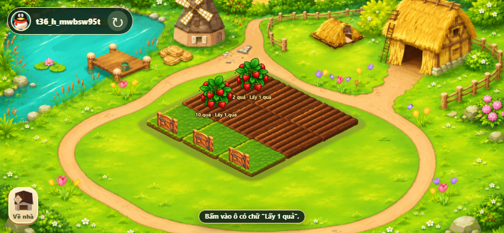
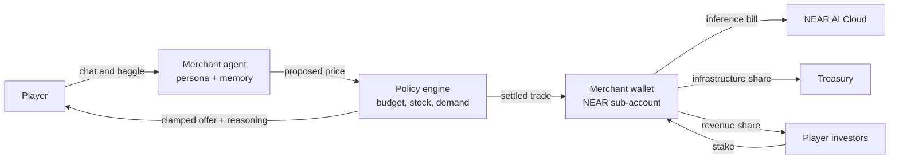

# FarmVerse · Nông Trại Mộng Mơ

**English name:** FarmVerse · **Vietnamese name:** Nông Trại Mộng Mơ

A browser farming game where the market is the game. You grow crops, then sell them to merchants whose prices come from their own purse, their own shelves and what players did in the last few minutes. The design gives every merchant a NEAR wallet, a personality you can bargain with, and bills it has to pay from what it earns.

Built at **NEAR HACKATHON 2026** · Track: **Games With Real Economies** (`games`)

**Play:** https://farmverse-ml2a.vercel.app · **Architecture:** [docs/ARCHITECTURE.md](docs/ARCHITECTURE.md) · **API:** [docs/API.md](docs/API.md)



## The problem

Game economies are usually spreadsheets. A shop buys strawberries at 20 forever, until a developer ships a patch. The shopkeeper is a vending machine: no budget, no stock, no reason to say no. Nothing a player does changes what the next player sees.

## The answer

FarmVerse treats each merchant as a small business:

- It has a **budget** and can run out of money.
- It has **shelves** and stops buying when they are full.
- It tracks **demand**, so a crop everyone dumps gets cheap and a crop nobody grows gets valuable.
- It can **go out of business** and close its stall.

On top of that pricing engine, the architecture gives each merchant an AI persona to haggle with, a NEAR sub-account as its wallet, and an operating bill for its own inference. [How the design works](#the-economy-design)

## The game loop

| Rhythm | What you do |
|---|---|
| Every 30 seconds | Plant, water, fertilize, harvest, clear a plot |
| Every 5 minutes | Take the harvest to market, see who pays best, sell, buy seeds for the next batch |
| Every session | Check in for the daily reward, finish the daily mission, visit friends' farms, take a fruit or get chased off by their pet |

## Try it

Open https://farmverse-ml2a.vercel.app. No sign-up, no wallet.

**Farm loop (about 90 seconds)**

1. Open the page. You start as a guest with 200 GOLD and six empty plots.
2. Open the seed shop and buy one strawberry seed. GOLD drops from 200 to 190.
3. Open the seed bag, choose the seed, tap an empty plot. The crop is planted and you gain 5 XP.
4. Wait 30 seconds, or water it to ripen 10% sooner. The plot shows the crop growing through its stages.
5. Tap the ripe crop. Between 10 and 29 strawberries go to the warehouse.
6. Open the warehouse and sell them at 20 GOLD each. You now have more GOLD than you started with.
7. Pick the shovel and tap the plot to clear it for the next crop.
8. Reload the page. GOLD, XP, plots and warehouse are unchanged; progress is saved in PostgreSQL.

**Social loop**

1. Tap the friends icon and create an account with a username and password. Your guest farm becomes that account's farm.
2. Open the Residents tab and pick a player. You are now on their farm.
3. Tap a ripe plot marked "Lấy 1 quả" (take one fruit). Either the fruit lands in your warehouse, or their pet blocks you.
4. Go home. The farm's owner sees the visit in their journal.

**Merchant pricing (API)**

The merchant has no game screen yet, so watch it through the API. Prices are in GOLD.

```bash
B=https://farmverse-ml2a.vercel.app/api
curl -s -c jar -b jar $B/farm > /dev/null
curl -s -c jar -b jar $B/merchant
```

You see a merchant with `goldBudget: 200`, stock of 3 and 1, `demand: 5`, `pricing.buyMultiplier: 1.3`, and one open offer to buy a strawberry for 15 GOLD.

Now turn the offer down. Replace `OFFER_ID` with the `id` from `merchant.offers[0]`:

```bash
curl -s -c jar -b jar -X POST $B/merchant/reject -H 'Content-Type: application/json' -d '{"offerId":"OFFER_ID","expectedRevision":0,"expectedMerchantRevision":0}'
```

The response shows `demand: 6` and `buyMultiplier: 1.36`. You refused to sell, so the merchant will bid higher next time. Offers last 20 seconds; an offer left to expire has the same effect as a rejection.

## The economy design

Full specification: [docs/ARCHITECTURE.md](docs/ARCHITECTURE.md). The summary:



- **Merchants with personalities.** Each merchant has its own system prompt and trading temperament. Bà Tư the grocer is warm and cautious. Chú Bảy the seed seller loves a gamble. You chat, make an offer, and they counter.
- **The model talks, the rules decide.** The language model proposes a price. The policy engine clamps it to a band computed from the merchant's budget, stock and demand. Chat cannot talk a merchant into a deal the engine would refuse, and the model never signs anything.
- **Each merchant has a wallet.** A named NEAR sub-account holds the merchant's operating balance. Its key can call only the game contract's trade method, with per-trade and daily caps.
- **Merchants pay their own way.** Every conversation is metered and charged to the merchant that had it. A merchant that cannot pay goes quiet and falls back to plain engine prices. A merchant with no GOLD and no stock closes, until players invest to reopen it for a share of its revenue.
- **No developer patch.** Prices move because players and merchants traded. Merchants restock from each other. Stalls open and close.
- **The chain stays out of sight.** Players sign in with a username or social login. Trades settle through a relayer as meta-transactions, so there is no wallet popup, seed phrase or gas prompt.

## How NEAR fits

| Need | NEAR building block | Role in the design |
|---|---|---|
| A wallet per merchant | Named sub-accounts | `ba-tu.npc.farmverse.testnet` is a merchant, readable by anyone |
| Give an AI money without the keys to everything | Function-call access keys | The agent runtime can call one contract method and nothing else |
| One contract for every item | NEP-245 multi token | Seeds, crops, fertilizer and GOLD are token ids in one contract |
| No gas prompts | Meta-transactions (NEP-366) | A relayer pays gas for player and merchant trades |
| Merchant voices | NEAR AI Cloud | Inference for persona chat, billed to each merchant |
| Pay bills in any asset | NEAR Intents | Converts earnings into what a compute or hosting provider charges in |

## What is in this repository

| Component | State |
|---|---|
| Farm loop: 16 crops, seed shop, watering, fertilizer, harvest, warehouse sales, XP and levels | Running, playable in the browser |
| Missions, 7-day attendance, guard pets | Running, playable in the browser |
| Accounts, friends, farm visits, stealing, activity journal | Running, playable in the browser |
| Merchant pricing engine: budget, stock, demand, timed offers, liquidation, closure | Running on the API ([`backend/src/merchant.ts`](backend/src/merchant.ts)); no game screen |
| Merchant personas, chat and bargaining | Specified in [ARCHITECTURE.md](docs/ARCHITECTURE.md) §4 |
| NEAR accounts, NEP-245 contract, relayer, self-funding loop | Specified in [ARCHITECTURE.md](docs/ARCHITECTURE.md) §5–8 |

The repository contains no smart contract, no NEAR SDK and no language-model calls. GOLD and items are rows in PostgreSQL.

## Run locally

Needs Node.js 20.12 or newer, pnpm, and PostgreSQL (Docker is the quickest way).

**Backend**

```bash
cd backend
cp -n .env.example .env        # then fill in POSTGRES_PASSWORD, DATABASE_URL, PORT=8092
docker compose up -d --wait postgres
pnpm install --frozen-lockfile
pnpm migrate
pnpm seed:friends              # 10 resident farms to visit
pnpm dev
```

**Web**, in a second terminal from the repository root:

```bash
pnpm --dir web install --frozen-lockfile
pnpm --dir web dev
```

Open http://127.0.0.1:5174. The web dev server proxies `/api` to the backend on port 8092.

**Tests**

```bash
cd backend && pnpm typecheck && pnpm exec node --env-file=.env --import tsx --test test/*.test.ts
pnpm --dir web test
```

`backend/test/merchant.test.ts` covers the pricing engine. More detail: [backend/README.md](backend/README.md) · [web/README.md](web/README.md) · [deployment](docs/POSTGRES_MIGRATION_PLAN.md)

## Stack

| Layer | Choice |
|---|---|
| Game client | Phaser 3, TypeScript, Vite |
| API | Node.js, TypeScript, Hono |
| Database | PostgreSQL (Supabase in production) |
| Shared rules | Engine-independent TypeScript in [`shared/`](shared/) |
| Hosting | Vercel: static client plus one serverless function |

## Hackathon disclosures

- All code was written during the hackathon window; the first commit is dated 2026-11-09.
- Libraries: Phaser, Vite, Hono, `pg`, `tsx`, esbuild, Vitest.
- Code was written with AI coding agents (Codex, Google Antigravity, Claude Code) under human direction.
- Sprites and backgrounds were produced with AI image generation and edited by the team. [Art Bible](docs/art/ART_BIBLE.md)

## Known limits

- The merchant trades only strawberry and corn, one unit per offer, and is reachable only through the API.
- Each farm has its own merchant; merchants are not yet shared between players.
- No real-time multiplayer. Other players' farms are loaded when you visit.
- The game text is in Vietnamese.
- A guest can spend all starting GOLD on fertilizer before buying a first seed.

## Security

- The server validates every request and owns all game rules. The client sends intents only.
- Sessions use HttpOnly cookies. Database row-level security is on, and public database roles have no access.
- No secrets are in the repository. `.gitignore` excludes `.env`, key files and credential folders.

## Docs

[Architecture](docs/ARCHITECTURE.md) · [Gameplay](docs/FARMVERSE_GAMEPLAY.md) · [API](docs/API.md) · [MVP contract](docs/FARMVERSE_MVP_CONTRACT.md) · [Agent economy amendment](docs/FARMVERSE_AGENT_ECONOMY_AMENDMENT.md)

## License

[MIT](LICENSE)
