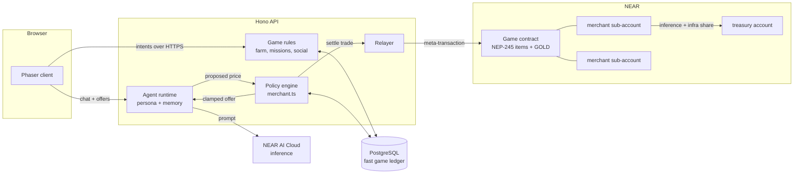
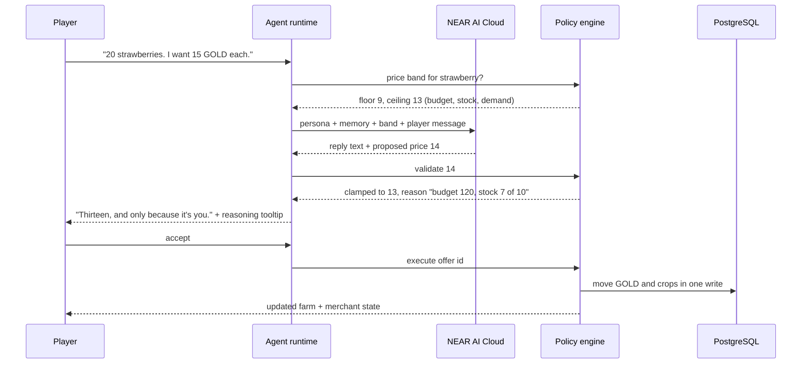
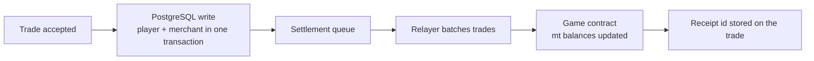
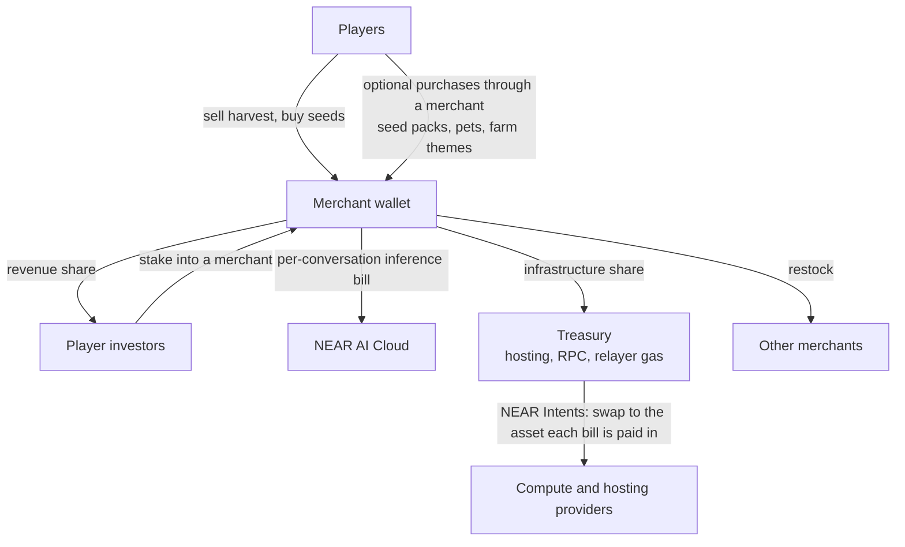

# FarmVerse architecture

**FarmVerse** (English) · **Nông Trại Mộng Mơ** (Vietnamese)

This document specifies how FarmVerse works as a game whose economy is run by its merchants. Each merchant is an AI agent with its own NEAR wallet, its own stock, its own personality and its own bills. Players farm, then chat and bargain with merchants to sell harvests and buy seeds. What merchants earn pays for their own AI inference and for the infrastructure they run on.

[Section 11](#11-component-status) lists which components are code in this repository and which are specified by this document. The agent and NEAR layers are a design; the farm, social layer and merchant pricing engine are running code.

## 1. Principles

1. **The server is the referee.** Phaser renders state and sends intents. The Hono API validates every request and owns every rule.
2. **The model talks, the rules decide.** A language model gives a merchant its voice and its opening position. A deterministic policy engine decides the price band, the caps and whether a deal is valid. The model never signs anything.
3. **Players never notice the chain.** No seed phrase, no wallet popup, no gas prompt in the game loop.
4. **One readable pricing file.** Every price a merchant can offer comes from [`backend/src/merchant.ts`](../backend/src/merchant.ts). Anyone can read why a price moved.
5. **Merchants can fail.** A merchant that trades badly runs out of money and closes. Nothing tops it up automatically for ever.

## 2. System overview



| Part | Responsibility |
|---|---|
| Phaser client | Draws the farm and the market, sends player intents, shows merchant chat and reasoning |
| Game rules | Crops, growth, harvest, missions, attendance, pets, friends, visits, stealing |
| Policy engine | Price bands, budgets, stock limits, offer lifetime, recovery and closure of merchants |
| Agent runtime | Loads a merchant's persona and memory, calls the model, turns replies into structured offers |
| Relayer | Wraps settled trades into NEAR meta-transactions and pays the gas |
| Game contract | Holds every item type and GOLD as NEP-245 token ids; enforces caps on merchant keys |
| PostgreSQL | Authoritative for moment-to-moment play; holds the settlement queue |

## 3. The game loop

| Rhythm | What the player does | What the economy does |
|---|---|---|
| Every 30 seconds | Plant, water, fertilize, harvest, clear a plot | Crops ripen; merchant offers expire and are re-priced |
| Every 5 minutes | Walk to the market, compare what each merchant will pay, haggle, sell the harvest, buy seeds for the next batch | Stock and demand shift each merchant's prices; a flooded crop gets cheap |
| Every session | Check in, finish the daily mission, visit friends, pick which crops to commit to, decide whether to back a struggling merchant | Merchants pay their inference bills, restock from each other, or close |

The decision that matters is the five-minute one: *what do I grow next, and who do I sell it to?* The answer changes because other players and merchants changed the market, not because a developer edited a table.

## 4. Merchant agents

### 4.1 Identity

Each merchant is a named NEAR sub-account of the game account, for example `ba-tu.npc.farmverse.testnet`. The account holds the merchant's operating balance. The game contract records the merchant's GOLD and item stock against that account id.

### 4.2 Persona

Each merchant has one persona file: a system prompt plus a small set of numbers the policy engine reads.

| Merchant | Voice | Trading temperament |
|---|---|---|
| Bà Tư, the grocer | Warm, gossipy, remembers your last harvest | Buys produce. Low risk appetite, narrow margins, pays more to regulars |
| Chú Bảy, the seed seller | Fast talker, loves a bet | Sells seeds. Wide price swings, discounts crops he thinks will be scarce |
| Cô Mai, the flower trader | Dry, precise, hates waste | Buys and sells rare crops. Holds stock for a better price, walks away easily |

A persona file sets:

- `voice`: the system prompt (tone, backstory, what the merchant cares about)
- `margin_floor` and `margin_target`: how hard the merchant pushes inside the allowed band
- `patience`: how many counter-offers before walking away
- `loyalty_weight`: how much past deals with this player shift the opening offer
- `preferred_crops`: crops the merchant pays a premium for

### 4.3 Memory

The agent runtime stores, per merchant and per player: the last deals, the prices agreed, whether the player walked away, and a short summary. That summary is included in the prompt, so a merchant can say "you sold me corn cheap yesterday, I can do better today" and mean it.

### 4.4 Bargaining protocol



Rules of the protocol:

- The model's output is parsed into `{ reply, side, crop, quantity, price }`. Anything else is discarded.
- The policy engine computes the band from the merchant's budget, stock and recent demand, then clamps the proposed price into it. A price outside the band can never reach the player.
- Every offer has an id and a lifetime, and can end only once: accepted, rejected or expired.
- A merchant counters at most `patience` times, then accepts or walks away.
- The reasoning shown in the tooltip is produced by the policy engine, not the model, so it is always true.

### 4.5 Pricing

The band comes from the engine already in [`backend/src/merchant.ts`](../backend/src/merchant.ts):

```text
budget   = clamp(goldBudget, 0, 300)
pressure = demand × (capacity − stock)

buyMultiplier  = 1 + pressure × budget / 20000          // what the merchant pays
sellMultiplier = 1 + pressure × (300 − budget) / 20000  // what the merchant charges
```

- A rich merchant with empty shelves pays well. A merchant with full shelves or an empty purse pays little.
- When players reject or ignore a sell offer, demand falls and the price drops. When they turn down a buy offer, demand rises and the next bid is higher.
- A merchant sells at three times the base price it buys at, so buying from one merchant to sell straight back never profits.

## 5. Wallet safety

A merchant holds money, and a language model is in the loop. The design keeps those two facts apart.

| Risk | Control |
|---|---|
| The model is talked into a bad deal | The policy engine clamps every price to the band. Chat cannot widen the band |
| Prompt injection asks the merchant to "send all your GOLD" | The model has no signing ability and no tool that transfers funds. It returns text and a proposed price |
| The agent runtime is compromised | It holds only a function-call access key, scoped to the game contract's `trade` method. That key cannot transfer NEAR or call any other contract |
| A bug drains a merchant through many small trades | The contract enforces a per-trade cap and a daily cap per merchant account |
| Keys leak from the server | Full-access keys for merchant accounts are kept offline by the game owner. Function-call keys can be rotated without moving funds |

## 6. Items and currency

One NEP-245 multi-token contract holds every asset type:

| Token id | Meaning |
|---|---|
| `gold` | GOLD, the game currency |
| `seed:<cropId>` | Seeds for one of the crop species |
| `crop:<cropId>` | Harvested produce |
| `fert` | Fertilizer |

GOLD is a game currency. It is not listed anywhere and has no price outside the game. The track is judged on the game loop, so the design adds no speculative token.

PostgreSQL stays authoritative for planting, growth and harvest, which happen many times a minute. Trades with merchants are the economic events, and those settle to the contract:



If the chain is unreachable, play continues and the queue drains later. Each trade keeps its receipt so anyone can check a merchant's books against the contract.

## 7. The invisible chain

| Player sees | What happens underneath |
|---|---|
| Opens the game and plays as a guest | A guest session cookie; no account on chain yet |
| Signs up with a username, email or social login | The server creates a NEAR account for the player and holds a function-call key for it |
| Sells 20 strawberries to Bà Tư | The trade is settled by the relayer as a meta-transaction (NEP-366). The relayer pays the gas |
| Wants to leave with their items | The player adds their own key to the account and the server's key is removed |

There is no wallet popup, no gas prompt and no seed phrase in the normal loop.

## 8. The self-funding loop

A merchant is a small business. It has income, costs and a balance, and it survives only while income covers costs.



**Two balances per merchant**

- **GOLD**, the trading balance. It rises and falls with every deal and sets the merchant's prices.
- **Operating balance** in NEAR. It pays for the merchant's inference and its share of infrastructure.

**Income**

- Margin between what the merchant pays for produce and what it sells for.
- A share of optional real-money purchases made through that merchant.
- Stakes from players who invest in the merchant.

**Costs**

- Each conversation is metered. The merchant's account is charged for the tokens it used.
- A fixed share of hosting, RPC and relayer gas, paid to the treasury.

**What happens when the money runs out**

| State | Trigger | Behaviour |
|---|---|---|
| Thriving | Operating balance and GOLD above thresholds | Full persona chat, haggling, memory |
| Frugal | Operating balance low | Short replies, fewer counter-offers, a cheaper model |
| Silent | Operating balance empty | Deterministic offers only, no chat. The merchant still trades at engine prices |
| Liquidating | GOLD below 30 and stock unsold after three failed sales | Sells stock at base price to recover |
| Closed | No GOLD, no stock, grant already used | The stall is shut. Players can invest to reopen it for a revenue share |

The last two states already exist in the pricing engine as `LIQUIDATION`, `OPERATING_GRANT` and `OUT_OF_BUSINESS`.

**NEAR Intents** convert a merchant's or the treasury's earnings into whatever asset a provider bills in, across chains, without the game holding a bridge. Intents run on mainnet only, so this part of the loop is exercised with small amounts on dedicated accounts.

## 9. An economy with no developer patch

- **Prices are emergent.** They come from each merchant's stock, budget and demand. If every player grows strawberries, strawberries get cheap and corn becomes the smart crop.
- **Merchants differ.** Persona numbers make one merchant cautious and another reckless, so the same market state produces different offers at different stalls.
- **Merchants trade with each other.** A seed seller short on stock buys from a wholesaler merchant through the same `trade` path a player uses.
- **Players own part of the market.** Investing in a merchant buys a revenue share. Enough stake lets a player set that merchant's persona numbers within limits.
- **Shops open and close.** Closures remove buyers, which shifts demand to the merchants left standing.
- **Fast-forward mode.** A simulation runs a week of trading in a minute against the same pricing file, so a judge can watch prices move, a merchant go under and another take its customers.

## 10. Data model and API

**In PostgreSQL today**

| Table | Holds |
|---|---|
| `farm_guest_progress` | Farm state (jsonb) and `merchant_state` per farm, with revision numbers for optimistic concurrency |
| `farm_accounts`, `farm_account_sessions` | Username accounts and sessions |
| `farm_friendships`, `farm_crop_steals` | Friends and the steal ledger |
| `farm_activities` | The journal of visits, steals and pet blocks |

**Specified additions**

| Table | Holds |
|---|---|
| `merchants` | One row per shared merchant: account id, persona id, balances, status |
| `merchant_memory` | Per merchant and player: recent deals and a summary |
| `trades` | Every settled trade with offer id, price, reasoning and chain receipt |
| `settlement_queue` | Trades waiting for the relayer |
| `inference_ledger` | Tokens and cost per conversation, charged to a merchant |

**Routes**

| Route | State |
|---|---|
| `GET /merchant`, `POST /merchant/accept`, `POST /merchant/reject` | In this repository |
| `POST /merchant/:id/chat` | Specified: player message in, reply plus structured offer out |
| `GET /market` | Specified: all merchants, their status and current offers |
| `POST /merchant/:id/invest` | Specified: stake into a merchant |
| `GET /market/simulate` | Specified: fast-forward run |

Full reference for the running routes: [API.md](API.md).

## 11. Component status

| Component | State | Where |
|---|---|---|
| Farm loop, missions, attendance, pets | Running | [`shared/farm-rules.mts`](../shared/farm-rules.mts), [`backend/src/app.ts`](../backend/src/app.ts), [`web/src/main.ts`](../web/src/main.ts) |
| Accounts, friends, visits, stealing, journal | Running | [`backend/src/community-routes.ts`](../backend/src/community-routes.ts), [`backend/src/activity-routes.ts`](../backend/src/activity-routes.ts) |
| Merchant pricing engine and API | Running on the API, no game screen | [`backend/src/merchant.ts`](../backend/src/merchant.ts), [`shared/merchant.mts`](../shared/merchant.mts) |
| Merchant personas, chat and bargaining | Specified in sections 4 and 5 | — |
| NEP-245 game contract, merchant sub-accounts, relayer | Specified in sections 5 to 7 | — |
| Self-funding loop, investment, fast-forward | Specified in sections 8 and 9 | — |

## 12. Failure modes

| Failure | Behaviour |
|---|---|
| Model provider is down or slow | Merchants fall back to deterministic offers with a canned line. Trading continues |
| Model returns malformed output | The reply is discarded and the engine's own offer is shown |
| NEAR RPC is down | Trades commit in PostgreSQL and wait in the settlement queue |
| Two requests race on the same farm | `expectedRevision` lets PostgreSQL accept one; the other gets 409 and refreshes |
| An offer is accepted twice | Offer ids resolve once; the second request gets 409 |

Invariants kept from the [MVP contract](FARMVERSE_MVP_CONTRACT.md): balances never go negative, stock stays within capacity, an offer ends exactly once, and the server is authoritative.
