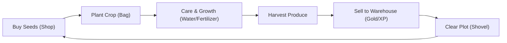

# FarmVerse — Gameplay Design Specification

Comprehensive specification of core mechanics, farming progression, social loops, daily missions, and pet systems.

---

## 1. Core Farming Loop

New players start as Guests with **200 GOLD**, **6 tilled plots**, Level 1, and empty inventory bags.

1. **Seed Shop:** Players can purchase seeds across the 15-crop catalog (1–99 units per order). Total cost = $\text{Quantity} \times \text{Seed Price}$.
2. **Planting:** Select seed from the Bag and tap an empty plot. Planting consumes 1 seed and awards **5 XP**.
3. **Growth & Care:**
   - Crops progress through distinct visual growth stages (Sprout → Seedling → Growing → Flowering → Ripe).
   - **Watering Can:** Free action; reduces base growth time by 10%. (Usable once per crop cycle).
   - **Fertilizer:** Costs 5 Gold per bag; reduces base growth time by 20%. (Usable once per crop cycle).
   - Combined care reduces growth duration by up to 30%.
4. **Harvest:** Tapping a ripe crop yields 10–29 produce items into the Warehouse and awards **1 XP**. The plot state changes to `NEED_CLEAR`.
5. **Warehouse & Clearing:**
   - Produce can be sold immediately from the Warehouse for Gold.
   - Players select the **Shovel** tool to clear withered stalks, earning **3 XP** and restoring the plot to `EMPTY` for the next cycle.

---

## 2. Progression & Leveling

- **Experience Points (XP):** Earned through planting, harvesting, and clearing plots.
- **Level-Up Threshold:** Calculated dynamically via $\text{Target XP} = \text{Current Level} \times 200$. Excess XP rolls over into the next level.
- **Session Continuity:** Guest sessions persist via HttpOnly cookies and database synchronization. Registering an account binds the active farm session permanently.

---

## 3. Daily Missions & 7-Day Attendance Streak

### First-Time Onboarding Quest:
- Objectives: Purchase seeds → Plant crop → Harvest ripe plant → Sell produce in Warehouse.
- Reward: One-time grant of **20 Gold**.

### Daily Active Mission:
- Objectives: Harvest at least 1 plot and sell a total of **3 produce items** in the Warehouse.
- Daily Reset: 00:00 UTC+7.
- Reward: **10 Gold**.

### 7-Day Attendance Streak Calendar:
Players tap **Check In Today** once per calendar day to claim consecutive rewards:

| Day | Attendance Reward |
|:---:|---|
| **1** | 5 Gold |
| **2** | 1 Strawberry Seed |
| **3** | 5 Gold |
| **4** | 1 Fertilizer Bag |
| **5** | 10 Gold |
| **6** | 2 Strawberry Seeds |
| **7** | 20 Gold |

*Missing a day resets the active streak to Day 1. Completing Day 7 advances the streak counter and begins a new cycle.*

---

## 4. Social & Community Loop

- **Neighbor & Resident List:** Players can browse fellow farmers, view player avatars, and visit neighbor farms.
- **Crop Stealing Mechanic:**
  - Visitors can steal 1 ripe fruit per plot from neighbor farms.
  - **Fairness Protection:** A plot can only be stolen from if at least 1 unit remains for the farm owner.
  - Steal attempts log an entry in the target farm's Activity Journal.

---

## 5. Guard Pets System

Farms can be guarded by one of three companion pets: **Dog**, **Cat**, or **Goose**.

| Pet Type | Idle & Walk Animation | Guarding / Defense Behavior |
|---|---|---|
| **Dog** | Plays playful tail-wagging & happy clips | Barks alert and blocks intruders from stealing crops |
| **Cat** | Cozily sleeps or ambles along paths | Leaps forward alertly to guard plots upon steal attempt |
| **Goose** | Walks with head bobbing, pecks grass | Flaps wings and honks aggressively to repel intruders |

### Guarding Logic:
- When an active pet successfully defends the farm, the steal action is blocked, leaving crop yield intact.
- A `pet_block` event is recorded in the Activity Journal, notifying the owner upon next login.
