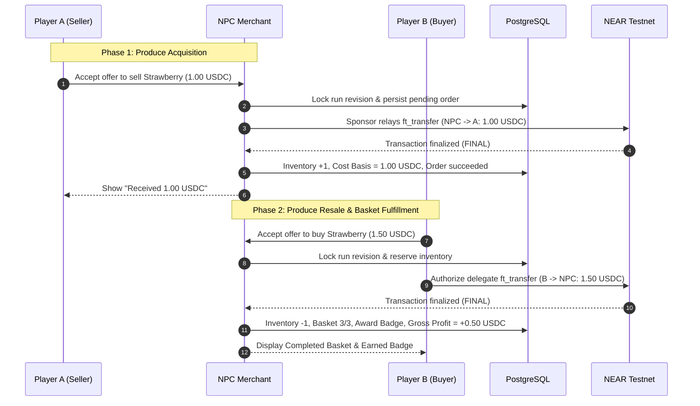

# NEAR USDC Trade Demo Architecture & Flow Design

System architecture and execution design for the gasless, sponsored NEAR testnet USDC trading scenario, seasonal basket fulfillment, and merchant ledger accounting.

---

## 1. Overview & Economic Model

The Trade Demo demonstrates real Web3 commerce seamlessly integrated into a web game:
- **Seller (Player A):** Exchanges a harvested Strawberry for **1.00 USDC**.
- **Merchant (NPC):** Purchases produce from Player A, holds inventory in escrow, and offers it to Player B.
- **Buyer (Player B):** Purchases the Strawberry for **1.50 USDC** to complete a 3/3 Seasonal Basket and unlock a commemorative badge.
- **Merchant PnL:** Automatically accounts for Cost Basis (1.00 USDC), Gross Revenue (1.50 USDC), and Gross Profit (+0.50 USDC).
- **Gasless Sponsorship:** All on-chain transactions are sponsored by the FarmVerse relayer; players never hold or pay NEAR for gas.

### Ledger & Balance Transitions:
| Participant | Post-Step 1 (Seller A completes) | Post-Step 2 (Buyer B completes) |
|---|---|---|
| **Player A** | `+1.00 USDC` | `+1.00 USDC` |
| **Player B** | `0.00 USDC` (Basket: 2/3) | `-1.50 USDC` (Basket: 3/3 + Badge) |
| **NPC Merchant** | `-1.00 USDC` (Inventory: 1 item) | `+0.50 USDC` Net Profit (Inventory: 0) |
| **Relayer** | Pays ~0.001 NEAR gas | Pays ~0.001 NEAR gas |

---

## 2. On-Chain Contracts & Testnet Infrastructure

- **Network:** NEAR Protocol Testnet.
- **USDC Contract:** Official Circle testnet contract `3e2210e1184b45b64c8a434c0a7e7b23cc04ea7eb7a6c3c32520d03d4afcb8af`.
- **Token Standards:** NEP-141 (Fungible Token) and NEP-366 (Meta-Transactions / Delegate Actions).
- **Decimals:** 6 decimal places for USDC (`1000000` = 1.00 USDC); 24 decimal places for NEAR gas tracking.
- **Storage Deposit:** Minimum storage deposit of `0.00125 NEAR` per account registered on the USDC token contract.

---

## 3. End-to-End Execution Sequence

---

## 4. Concurrency, Consistency & Recovery

1. **Reservation & Database Locks:**
   - Orders require exclusive inventory locks in PostgreSQL before payment intents are generated.
   - Prevents double-spending or simultaneous fulfillment attempts by multiple sessions.
2. **Deterministic State Reconciliation:**
   - Network timeouts, page refreshes, or dropped connections recover gracefully by polling `GET /api/trade-demo/orders/:orderId`.
   - The backend checks on-chain transaction hashes via RPC before updating terminal states.
3. **Idempotency Guarantees:**
   - All client mutation endpoints mandate a unique `requestId` (UUID v4) and `expectedRevision`.
   - Repeated requests with identical payloads return cached results; conflicting payloads return `409 REQUEST_CONFLICT`.
4. **Failure Recovery:**
   - Cancelled or reverted on-chain transactions release item reservations, returning the offer to active status.

---

## 5. Technical Architecture

- **Shared Core (`shared/trade-demo.mts`, `shared/payments.mts`):** Shared TypeScript types, status enums, and HTTP schemas independent of UI rendering engines.
- **Backend Service (`backend/src/trade-demo/`):** State machine, database store, validation rules, and integration with the NEAR payment adapter.
- **Frontend UI (`web/src/trade-demo/`):** Modular client component containing the produce stall, invitation cards, interactive basket view, transaction polling, and PnL ledger.
