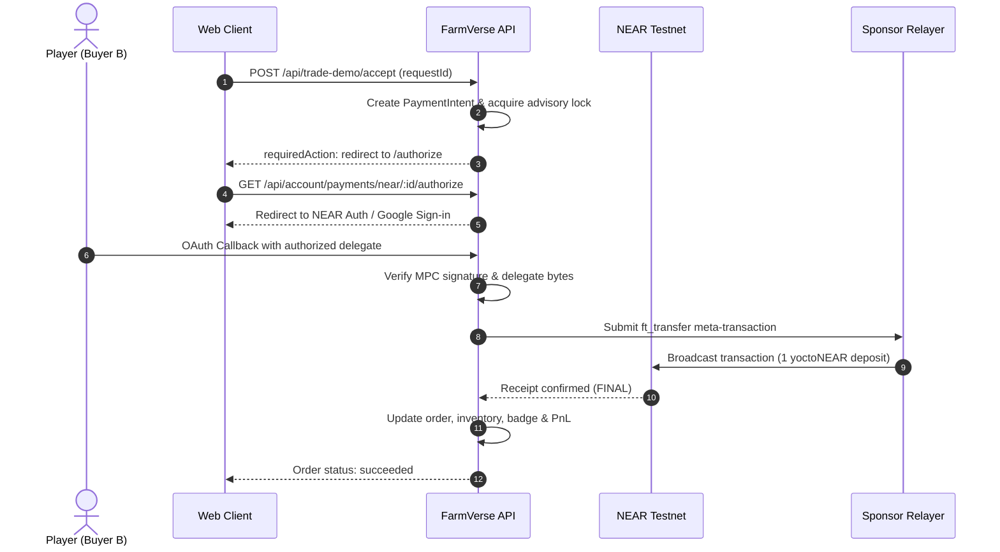

# NEAR USDC Payment Adapter Guide

Architecture and configuration guide for gasless, sponsored USDC payments on NEAR testnet using meta-transactions (NEP-366) and fungible tokens (NEP-141).

---

## 1. Overview & Architecture

The payment system decouples gameplay rules from blockchain settlement:
- **Core Interface:** Implemented via `PaymentProvider` in `shared/payments.mts`.
- **Provider Resolution:** Dynamic selection in `backend/src/payments/provider.ts` via `paymentProviderFor(farmId, providerId)`.
- **Blockchain Adapter:** The NEAR adapter manages RPC interaction, account provisioning, storage deposits, NEP-366 meta-transactions, NEAR Auth verification, MPC signatures, and receipt validation.

---

## 2. Configuration & Environment Variables

Configure the following variables in `backend/.env`:

```dotenv
# Enable NEAR demo features
NEAR_DEMO_ENABLED=true
NEAR_AUTH_CALLBACK_URL=http://localhost:3000/

# USDC Payment Adapter
NEAR_USDC_ENABLED=true
NEAR_TEST_SIGNING_SPONSOR_KEY=<server-side sponsor private key>
NEAR_USDC_NPC_KEY=<server-side NPC private key>
```

> [!IMPORTANT]
> - Never expose private keys, provisioning secrets, or credentials in client bundles or public version control.
> - The relayer/sponsor wallet pays all transaction gas fees on behalf of players. Player wallets maintain `0 NEAR` and transact purely in testnet USDC.
> - When `NEAR_DEMO_ENABLED` is omitted or set to `false`, social authentication buttons and blockchain routes gracefully disable (returning 404), falling back cleanly to standard Guest or username/password accounts.

---

## 3. Account Provisioning & Setup CLI

Execute setup and provisioning tasks from `backend/`:

```bash
# 1. Inspect on-chain balances and configuration status
pnpm near:setup

# 2. Register storage deposits and USDC token contracts for NPC & player wallets
pnpm near:setup --register

# 3. Fund a verified player wallet with initial testnet USDC
pnpm near:setup --fund-wallet <wallet-address>
```

- `--register`: Registers token contracts and storage deposits on NEAR testnet, funded by the sponsor wallet.
- `--fund-wallet`: Provisions verified accounts with testnet USDC for demo evaluation. Idempotent: repeated calls with the same seed ID prevent double funding.

---

## 4. Payment Execution Lifecycle



### Key Execution Stages:
1. **Intent Creation:** Server-authoritative price, sender, receiver, and idempotency key (`requestId`).
2. **Preparation (`prepare`):** Validates asset decimals, wallet registration, and balance sufficiency; registers a pending payment fingerprint.
3. **Authorization:**
   * **NPC Payout:** The server signs the delegate action directly with the secured NPC key and submits via the sponsor relayer.
   * **User Purchase:** The client is directed to the OAuth authorization endpoint (`/authorize`), validating identity and authorized transfer amounts.
4. **Relayed Broadcast:** The relayer broadcasts the signed `ft_transfer` action, paying gas fees.
5. **Receipt Verification (`getStatus`):** The adapter polls the NEAR RPC for transaction outcome, ensuring:
   * Block execution status is `FINAL`.
   * The execution tree contains a valid `nep141/1.0.0/ft_transfer` event emitted by the verified USDC contract.
   * The recipient address and atomic amount match the original `PaymentIntent`.

---

## 5. Security & Idempotency Safeguards

- **Replay Protection:** Each payment intent includes a persistent unique identifier stored in PostgreSQL. Repeated callbacks or double clicks return the existing transaction record.
- **Strict Token Verification:** The adapter exclusively interacts with the official Circle USDC contract on NEAR testnet. Arbitrary contract invocations are rejected.
- **Privacy:** Access tokens, authorization codes, and private keys are never stored in database tables or logs. Transaction logs only record public hashes, timestamps, and normalized token amounts.
