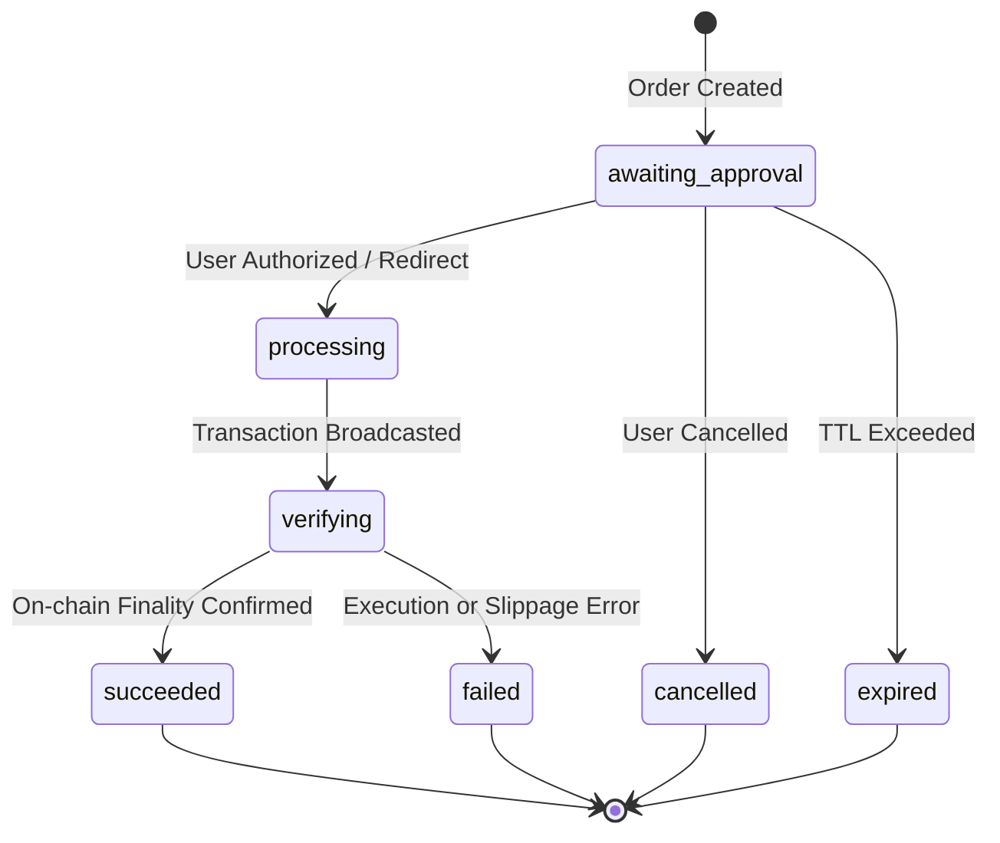

# USDC Trade Demo API Specification

Technical specification for the sponsored NEAR testnet USDC trading scenario, inventory exchange, seasonal basket badges, and merchant PnL accounting.

---

## 1. Overview & Currency Units

The Trade Demo simulates a multi-party marketplace where:
- **Player A (Seller):** Sells freshly harvested produce to the NPC Merchant for **1.00 USDC**.
- **Player B (Buyer):** Purchases seasonal produce from the NPC Merchant for **1.50 USDC** to complete a Seasonal Basket.
- **NPC Merchant:** Acts as intermediary, recording cost basis, revenue, gross profit (+0.50 USDC), and sponsored network gas fees.

### Currency Precision
- **USDC:** 6 decimal places (e.g., `1000000` = 1.00 USDC, `1500000` = 1.50 USDC). Amounts are serialized as atomic string representations to avoid floating-point inaccuracies.
- **NEAR:** 24 decimal places (used for sponsored gas fee accounting).
- **Timestamps:** `serverTime` in Unix milliseconds; order and badge timestamps in ISO 8601 strings.

---

## 2. HTTP Endpoints

All endpoints share the same origin, prefixed with `/api` and authenticated via session cookies.

| Method & Route | Request Body | Response Body | Description |
|---|---|---|---|
| `GET /api/trade-demo` | None | `TradeDemoSnapshot` | Fetches current trading stage, role, wallet balance, active offer, order status, and merchant PnL. |
| `POST /api/trade-demo/visit` | Empty body `{}` | `TradeDemoVisitResponse` | Queries or schedules the NPC visit arrival time for the current player's farm. |
| `POST /api/trade-demo/accept` | `TradeDemoActionRequest` | `TradeDemoActionResponse` | Accepts an offer. Returns `202 Accepted` during processing or `200 OK` on terminal state. |
| `POST /api/trade-demo/skip` | `TradeDemoActionRequest` | `TradeDemoActionResponse` | Dismisses an offer (`order: null`, `offerDismissed: true`). |
| `GET /api/trade-demo/orders/:orderId` | None | `TradeDemoOrderResponse` | Polls the current status of an order along with updated snapshot. |
| `GET /api/trade-demo/pnl` | None | `TradeDemoPnlResponse` | Retrieves comprehensive merchant ledger and PnL breakdown. |

### Action Request Schema:
```json
{
  "runId": "20000000-0000-4000-8000-000000000001",
  "offerId": "20000000-0000-4000-8000-000000000003",
  "requestId": "30000000-0000-4000-8000-000000000001",
  "expectedRevision": 0
}
```

### Idempotency & Concurrency:
- `requestId`: A UUID v4 generated once per user click. Network retries must resend the exact same `requestId`.
- Replaying the same `requestId` returns the cached result without re-executing transactions.
- Reusing a `requestId` with differing payloads returns a `409 REQUEST_CONFLICT`.
- `expectedRevision`: Optimistic concurrency control matching the latest snapshot revision.

---

## 3. Order Lifecycle & State Machine



| Order Status | Description | UI Behavior |
|---|---|---|
| `awaiting_approval` | Awaiting user signature or payment authorization. | Displays confirmation prompt or redirect button. |
| `processing` | Server is constructing transaction and acquiring advisory locks. | Shows loading spinner, locks input controls. |
| `verifying` | Transaction submitted to NEAR testnet, awaiting RPC finality. | Polls order status at 4-second intervals. |
| `succeeded` | Settlement confirmed. Inventory, badge, and PnL updated. | Displays success feedback, animates badge/item transfer. |
| `failed` | Transaction reverted or verification failed. | Displays localized error message, unlocks retry. |
| `cancelled` | Order intentionally abandoned by user. | Clears pending state, restores offer view. |
| `expired` | Order timed out before completion. | Prompts user to generate a new trade request. |

---

## 4. NPC Visit Scheduling & Farm Stall Flow

1. **Visit Scheduling (`POST /api/trade-demo/visit`):**
   - When a player enters their farm, the client checks if an NPC schedule exists.
   - If conditions are met (valid wallet, active run, pending trade role), the backend assigns an arrival time 6–12 seconds in the future.
   - When `arrivesAt` timestamp is reached, the NPC avatar appears on the farm.
2. **Farm Stall Interaction (`#quay-nong-san`):**
   - Clicking the NPC opens the Farm Stall modal.
   - The UI mounts the trade component, fetching `GET /api/trade-demo`.
   - Player reviews the offer, cost/sale price, and initiates transaction via `POST /api/trade-demo/accept`.

---

## 5. Merchant PnL & Ledger Model

The merchant accounting engine computes:
- **Cost of Goods Sold (COGS):** Total USDC disbursed to purchase produce from Player A.
- **Gross Revenue:** Total USDC received from selling produce to Player B.
- **Gross Profit:** $\text{Gross Revenue} - \text{COGS}$ (Expected: $+0.50\text{ USDC}$).
- **Network Fees:** Gas fees in atomic NEAR sponsored by the relayer wallet (not deducted from user USDC balances).

---

## 6. Error Handling

Errors follow the standard format:
```json
{
  "error": {
    "code": "REQUEST_CONFLICT",
    "message": "Phiên chơi đã thay đổi. Hãy thử lại.",
    "orderId": "..."
  }
}
```

| HTTP Status | Error Code | Recommended Client Action |
|---|---|---|
| `400 Bad Request` | `INVALID_ACTION` | Validate request payload against schema. |
| `401 Unauthorized` | `UNAUTHENTICATED` | Redirect user to Google / NEAR sign-in. |
| `404 Not Found` | `ORDER_NOT_FOUND` | Clear stale order reference, reload snapshot. |
| `409 Conflict` | `REVISION_MISMATCH` | Refresh snapshot, re-evaluate button availability. |
| `503 Service Unavailable` | `PAYMENT_UNCONFIRMED` | Continue polling order status until finality. |
