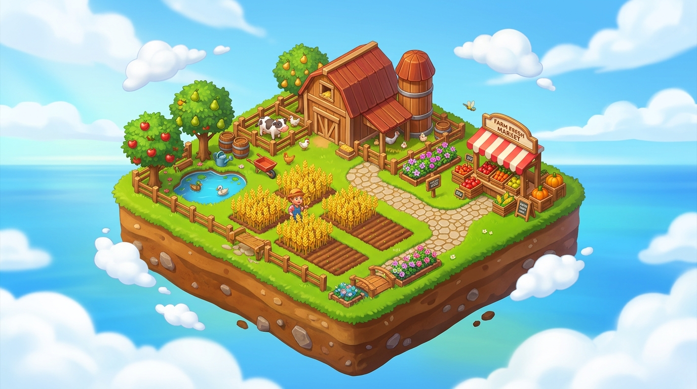

# FarmVerse Art Bible

Use this guide whenever Codex or Antigravity generates, edits, or integrates FarmVerse art. The [Phaser MVP guide](../FARMVERSE_PHASER_MVP_GUIDE.md) defines the visual direction. This document records the locked master reference and asset standards.

## Approved Style Reference

- **Status:** **APPROVED** by Project Owner (2026-11-09).
- **Master Reference File:** [`docs/art/approved_style.png`](approved_style.png) *(Source: `art/source/style_candidate_farmery.jpg`)*

### 1. Camera Projection & Angle
- **Projection:** Fixed 2.5D Isometric view with a classic ~30-degree tilt (standard 2:1 dimetric pixel ratio).
- **Consistency:** The same fixed camera angle, scale, and lighting direction apply across both Scene A (My Farm) and Scene B (Town Square / Store).

### 2. Land Composition & Expansion Model
- **Unified Continuous Land:** The farm is presented on a single, spacious, continuous parcel of land (clean 3D cross-section earth cutaway layers along outer edges showing rich soil and stone). No fragmented floating bridges or floating mini-islands to maintain optimal visual cleanliness and peace.
- **Locked Expansion via Wooden Fences:** Expansion areas and locked plots are located on the same continuous ground, separated by rustic wooden post-and-rail fences (`wooden_fence`) with a gate/padlock indicator. Unlocking an area (e.g., paying 20 GOLD for Plot #3) removes the fence barrier and opens the tilled bed for immediate planting.

### 3. Visual Style & Rendering
- **Art Direction:** High-polish 2.5D stylized casual game art, inspired by classic cheerful farming hits (*Farmery: Nông Trại Sói Ca*, *Hay Day*).
- **Rendering Quality:** Volumetric 3D feel with smooth hand-painted digital textures, warm ambient occlusion, and crisp readable outlines.
- **Strict Invariants:**
  - **NOT** pixel art.
  - **NOT** photorealistic 3D render.
  - **NOT** dark fantasy or gritty medieval.
  - **NOT** oversaturated neon candy colors.

### 4. Color Palette
- **Grass & Foliage:** Lush emerald green (`#55b837`), vibrant lime highlights (`#83d84a`), deep forest shadow (`#274e1d`).
- **Tilled Earth & Soil:** Rich chocolate brown furrow beds (`#5c3716`, `#4a2c11`), warm soil highlights (`#7a4d2c`).
- **Crops:**
  - *Normal Crop:* Bright golden-amber wheat stalks (`#f4b938`, `#d99726`).
  - *Golden Crop:* Gleaming pure yellow-gold with sparkles (`#ffd700`, `#fff176`).
- **Wood & Architecture:** Warm natural cedar/pine timber planks (`#8b5a2b`), terracotta red-clay roof tiles (`#b84d33`), red-and-white striped market canopy.
- **Water:** Crisp azure blue with floating green lily pads and orange koi fish (`#4aa3df`, `#2b76a8`).

### 5. Modular Scale & Upgrade Tiers
- **Plots:** Modular rectangular tilled plots (~150×95 px) with clearly distinguishable states (`EMPTY`, `GROWING` sprout, `READY` crop).
- **Buildings (Level 1 Starter Aesthetic):**
  - *Farmhouse:* Level 1 cozy wooden cottage with red tile roof.
  - *Silo / Barn:* Level 1 compact wooden grain silo with conical cap (10 item capacity).
  - *Merchant Stall:* Level 1 wooden market counter with striped awning, produce crates, and chalkboard.
  - *Fish Pond:* Level 1 circular stone-rimmed koi pond.
  - *Upgrade Path:* Designed with clean ground contact footprints so future tiers (Level 2 & 3) can scale upward without breaking isometric tile alignment.

---

## Generate or revise a sprite

1. Read the approved reference [`approved_style.png`](approved_style.png) and inspect existing game assets.
2. Specify the asset's role, camera angle (isometric 30°), scale, palette, lighting (warm afternoon from upper-left), canvas size, and transparent background (`.png`).
3. Check dimensions, transparency, cropping, anchor/origin (typically bottom-center for isometric placement), and visual contrast against the green grass.
4. Save source/editable originals in `art/source/` and game-ready production copies in `web/public/assets/`.

## Asset handoff

For each asset, include its ID or filename, path, intended scene or state, pixel dimensions, anchor point, prompt or source reference, and approval status. Keep this information with the task handoff.
